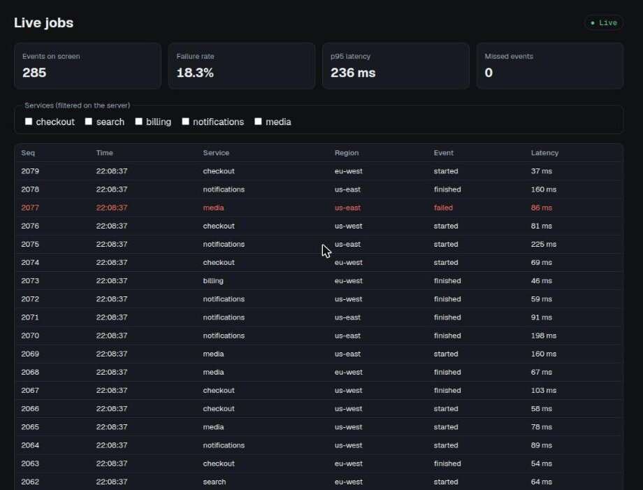

# Real-time dashboard starter: Next.js + FastAPI WebSockets

A small, working starter for **live dashboards**: a FastAPI WebSocket server that streams events to many browsers, and a Next.js / React dashboard that stays fast and honest when the connection drops.

It's the pattern we use at **[BuildKodiq](https://buildkodiq.com)** for real-time screens (trading-style terminals, operations dashboards, live analytics), stripped down to what every one of them needs. The feed here is simulated job events; swap `produce()` in `server/main.py` for your real source.



## What it handles

**Server (FastAPI, `server/main.py`)**
- Snapshot on connect, then live events, each with a sequence number so clients can detect gaps
- One bounded queue per client: a slow client drops its *own* oldest events and never stalls the broadcast for everyone else
- Per-connection filters (`{"type": "subscribe", "services": [...]}`), validated with Pydantic; unknown messages get an error, not a crash
- Heartbeat pings every 15 s so dead connections are noticed
- History and search over REST (`GET /api/events?before_seq=&service=&limit=`), not over the socket

**Client (Next.js, `web/lib/live.ts`)**
- One WebSocket and one store outside React, read with `useSyncExternalStore`
- Incoming events buffered and applied **once per animation frame**, so hundreds of messages a second cause at most one render per frame
- Reconnect with exponential backoff **and jitter**; resubscribe on reconnect; trust the fresh snapshot, not stale screen state
- Watchdog: no message for 40 s → the connection is treated as dead and reopened
- Visible connection state (`Live` / `Reconnecting` / `Offline`); stale data is never shown as live
- Messages validated at the edge: malformed events are logged and dropped
- Missed-event counter from sequence gaps
- Client-side re-check of filters, because events already in flight when a filter changes can still arrive

## Run it

```bash
# 1. server (Python 3.11+)
cd server
python -m venv .venv && . .venv/bin/activate
pip install -r requirements.txt
uvicorn main:app --port 8765          # EVENTS_PER_SECOND=200 to stress it

# 2. dashboard (Node 20+)
cd web
npm install
npm run dev                            # http://localhost:3000
```

Config: `EVENTS_PER_SECOND`, `CORS_ORIGINS` (server); `NEXT_PUBLIC_WS_URL`, `NEXT_PUBLIC_API_URL` (web).

## Taking it to production

What we usually add on real projects:
- Auth on the WebSocket handshake (decide what a user may see when the socket opens)
- Paid tiers / usage credits via Stripe, with balances always refreshed from the server and idempotent webhook handling
- Redis pub/sub (or your broker) between the producer and several server instances
- Virtualised tables for thousands of visible rows; canvas charts for high-frequency series
- A recorded or simulated peak feed replayed at 2–3× expected rate in CI

Background and the lessons behind each choice: [Building a real-time dashboard on Next.js and WebSockets](https://buildkodiq.com/blog/real-time-dashboard-nextjs-websockets).

## Who made this

[BuildKodiq](https://buildkodiq.com) is a two-engineer AI and web engineering studio ([Shubham Maurya](https://buildkodiq.com/team/shubham-maurya), [Rishabh Maurya](https://buildkodiq.com/team/rishabh-maurya)). We build real-time dashboards and WebSocket apps, backends on Go, Python and Temporal, AI agents and SaaS MVPs. See [real-time dashboard work](https://buildkodiq.com/services/real-time-dashboards) or email hello@buildkodiq.com.

MIT licensed.
